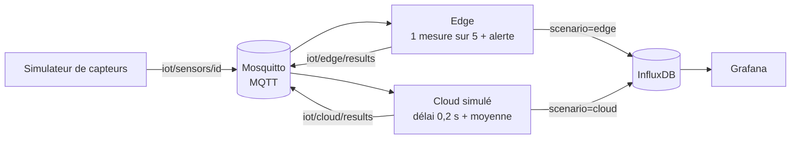

# IoT Edge–Cloud avec capteurs simulés

Plateforme qui compare deux manières de traiter des mesures de capteurs :

- **Cloud** : chaque mesure est traitée par un service distant (délai simulé).
- **Edge** : un service local filtre les mesures et déclenche lui-même les alertes.

Tout tourne dans des conteneurs Docker, avec un broker MQTT, une base InfluxDB et un tableau de bord Grafana.

> Le délai du Cloud (0,2 s par mesure) est **artificiel** : il simule un lien et un traitement distants. Il doit être signalé comme tel dans tous les résultats.

## Architecture



Les services Edge et Cloud reçoivent les mêmes mesures en parallèle, ce qui rend la comparaison équitable. Ils sont dans des conteneurs séparés : on peut couper l'un sans toucher à l'autre.

## Prérequis

- Docker avec Docker Compose
- Git
- Python 3 (seulement pour `benchmark.py` et `coupure.py`)

## Démarrage

```bash
git clone https://github.com/FATIMA-ZOHRA3/iot-edge-cloud.git
cd iot-edge-cloud
docker compose up -d --build
docker compose ps
```

Six services doivent être `running` : `mosquitto`, `influxdb`, `grafana`, `simulator`, `cloud`, `edge`.

| Service | Adresse | Identifiants (développement uniquement) |
|---------|---------|----------------------------------------|
| Grafana | http://localhost:3000 | `admin` / `motdepasse-iot-2026` |
| InfluxDB | http://localhost:8086 | `admin` / `motdepasse-iot-2026` |
| MQTT | `localhost:1883` | sans authentification |

Arrêter : `docker compose down` (les données d'InfluxDB et de Grafana sont conservées dans des volumes).

> Ces identifiants servent uniquement aux essais en local. Ne les réutilise pas ailleurs.

## Tableau de bord Grafana

Le dashboard **IoT Edge vs Cloud** est chargé automatiquement au démarrage : ouvrir http://localhost:3000 puis **Dashboards**. Il contient trois panneaux :

1. **Latence de traitement** Edge et Cloud, en ms (échelle logarithmique).
2. **Débit** en messages par seconde.
3. **Température** en temps réel, avec le seuil d'alerte de 32 °C.

La source de données et le dashboard sont décrits dans `grafana/provisioning/` et `dashboard/`.

## Voir les messages MQTT

```bash
docker compose exec mosquitto mosquitto_sub -h localhost -t "iot/#" -v
```

| Topic | Contenu |
|-------|---------|
| `iot/sensors/<id>` | mesure brute d'un capteur |
| `iot/edge/results` | mesure retenue par l'Edge et indicateur d'alerte |
| `iot/cloud/results` | moyenne glissante calculée par le Cloud |

## Configuration

Les réglages sont lus dans les variables d'environnement des services (`docker-compose.yml`).

| Variable | Service | Rôle | Défaut |
|----------|---------|------|--------|
| `N_SENSORS` | simulator | nombre de capteurs | 1 |
| `INTERVAL_SECONDS` | simulator | secondes entre deux mesures | 2 |
| `CLOUD_DELAY_SECONDS` | cloud | délai artificiel | 0,2 |
| `WINDOW_SIZE` | cloud | taille de la moyenne glissante | 10 |
| `EDGE_BATCH` | edge | 1 mesure conservée sur N | 5 |
| `ALERT_THRESHOLD` | edge | seuil d'alerte (°C) | 32 |

## Benchmark

Mesure, pendant une durée donnée, le nombre de messages, les octets et la latence moyenne de chaque flux.

```bash
python -m pip install -r requirements.txt
python benchmark.py --duration 120
```

Les services doivent tourner. Le résultat est affiché et écrit dans `results/benchmark.csv` (dossier non versionné).

Le tableau des essais avec 1, 5 et 10 capteurs est dans `docs/resultats_charge.csv`.

| Capteurs | Flux | Messages | Octets | Latence moyenne (ms) |
|---------:|------|---------:|-------:|---------------------:|
| 1 | cloud | 60 | 13 907 | 212,3 |
| 1 | edge | 17 | 3 818 | 11,9 |
| 5 | cloud | 300 | 69 539 | 633,5 |
| 5 | edge | 98 | 21 991 | 26,7 |
| 10 | cloud | 571 | 132 338 | 4 912,4 |
| 10 | edge | 208 | 46 664 | 44,0 |

À 10 capteurs, le Cloud sature : il traite un message à la fois avec un délai de 0,2 s, soit 5 messages par seconde au maximum.

## Scénario de coupure du Cloud

```bash
python coupure.py --duree 60
```

Le script arrête le service Cloud pendant la durée indiquée, puis le relance. Pendant la coupure, l'Edge continue de traiter les mesures et d'écrire dans InfluxDB, alors que le Cloud n'écrit plus rien (voir `docs/coupure-influxdb.png`). Les mesures émises pendant la coupure ne sont pas rattrapées par le Cloud.

Équivalent manuel : `docker compose stop cloud`, puis `docker compose start cloud`.

## Structure du dépôt

```
simulator/        capteurs simulés (sensors.py) et publication MQTT (publisher.py)
edge/             service Edge (processor.py)
cloud/            service Cloud simulé (consumer.py)
grafana/          configuration automatique de Grafana (source InfluxDB, dashboards)
dashboard/        dashboard Grafana au format JSON
docs/             rapport, schéma d'architecture, captures et tableau des résultats
results/          mesures du benchmark (CSV, non versionnés)
benchmark.py      messages, octets et latence par flux
coupure.py        simulation d'une coupure du Cloud
docker-compose.yml  tous les services
mosquitto.conf    configuration du broker (essais locaux uniquement)
```

## Limites

- Les capteurs sont **simulés**, avec des valeurs tirées au hasard.
- Le **délai du Cloud est artificiel** et son traitement est séquentiel.
- Un seul broker MQTT sert aux deux chemins, sur une seule machine : les valeurs absolues ne sont pas celles d'un déploiement réel, seuls les écarts entre Edge et Cloud sont significatifs.
- Chaque essai du benchmark est une mesure unique de 2 minutes.

## Rapport

Voir `docs/` : `RAPPORT_partie_A.md` (introduction, problématique, architecture, choix techniques) et son PDF.

## Auteurs

Projet réalisé par Fatima Zohra (Dev A) et Safaa (Dev B), ENSAH.
