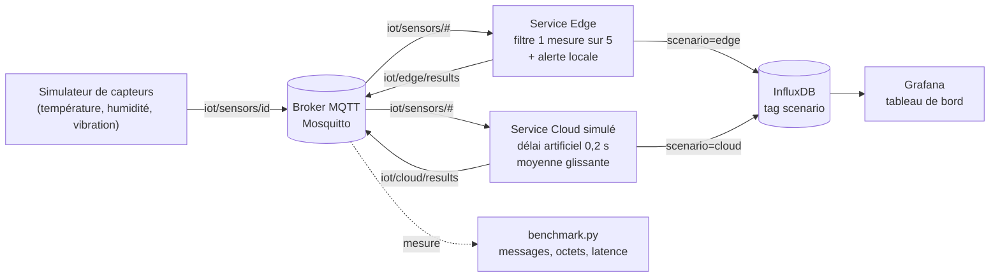

# Traitement Edge et Cloud de données de capteurs simulés

*Projet IoT Edge–Cloud — ENSAH*

> Partie A du rapport : introduction, problématique, architecture et choix techniques.
> La partie B (protocole de test, résultats, discussion, conclusion) est rédigée séparément.

---

## 1. Introduction

L'Internet des objets (IoT) repose sur un grand nombre de capteurs qui produisent en continu des mesures : température, humidité, vibrations, etc. Ces mesures sont généralement envoyées vers un serveur distant, le **Cloud**, qui dispose de grandes capacités de calcul et de stockage. Cette approche est simple, mais elle a un coût : chaque mesure traverse le réseau, ce qui augmente le volume de données transmises et le temps de réponse.

Le **Edge computing** propose de rapprocher le traitement de la source des données. Un service installé près des capteurs filtre et analyse les mesures sur place, et ne transmet que l'information utile. L'objectif est de réagir plus vite, d'envoyer moins de données et de continuer à fonctionner même quand le lien vers le Cloud est coupé.

Ce projet met en place, avec des **capteurs simulés**, une plateforme qui permet de **comparer ces deux manières de traiter les mesures** :

- un traitement **Cloud**, où chaque mesure est traitée par un service distant ;
- un traitement **Edge**, où un service local filtre les mesures et déclenche lui-même les alertes.

Les deux traitements s'exécutent dans des conteneurs séparés et leurs résultats sont stockés, visualisés et mesurés avec les mêmes outils, afin de pouvoir les comparer de façon équitable.

---

## 2. Problématique

### 2.1 Question posée

> **Dans quelle mesure un traitement en périphérie (Edge) permet-il de réduire la latence et le volume de données par rapport à un traitement centralisé dans le Cloud, et que se passe-t-il quand le Cloud devient indisponible ?**

### 2.2 Pourquoi l'Edge ?

Trois raisons motivent cette étude :

1. **La latence.** Une décision qui doit être prise en quelques millisecondes (par exemple une alerte de température trop élevée) ne peut pas attendre un aller-retour vers un serveur distant.
2. **Le volume de données.** Envoyer toutes les mesures brutes consomme de la bande passante et du stockage. Un filtrage local ne conserve que l'essentiel.
3. **La résilience.** Si le lien vers le Cloud tombe, un système entièrement centralisé s'arrête. Un système doté d'un traitement local peut continuer à décider.

### 2.3 Hypothèses à vérifier

| N° | Hypothèse | Indicateur mesuré |
|----|-----------|-------------------|
| H1 | L'Edge répond plus vite que le Cloud | latence moyenne (ms) |
| H2 | L'Edge produit moins de messages et d'octets | nombre de messages, octets |
| H3 | L'Edge continue de fonctionner quand le Cloud est coupé | résultats écrits pendant une coupure |
| H4 | Le comportement reste correct quand le nombre de capteurs augmente | essais avec 1, 5 et 10 capteurs |

### 2.4 Limites du périmètre

- Les capteurs sont **simulés** : les valeurs sont tirées au hasard dans des plages réalistes.
- Le **délai du Cloud est artificiel** (voir section 4.5) : il représente un lien et un traitement distants, mais ce n'est pas une mesure sur un vrai Cloud.
- Tout fonctionne sur une seule machine, avec un seul broker MQTT. Les temps absolus ne sont donc pas ceux d'un déploiement réel ; ce sont les **écarts entre Edge et Cloud** qui sont significatifs.

---

## 3. Architecture

### 3.1 Vue d'ensemble

*Figure 1 : architecture de la plateforme. Le simulateur publie les mesures sur le broker. Les services Edge et Cloud s'y abonnent en parallèle, chacun produit ses résultats, les publie et les écrit dans InfluxDB. Grafana affiche les données ; `benchmark.py` écoute les trois flux pour les mesurer.*

Le principe est de faire **traiter chaque mesure par les deux chemins en parallèle** : le chemin Edge et le chemin Cloud reçoivent exactement les mêmes mesures, ce qui rend la comparaison équitable.

### 3.2 Les composants

| Composant | Dossier | Rôle |
|-----------|---------|------|
| Simulateur | `simulator/` | Génère des mesures (température, humidité, vibration) et les publie sur MQTT. Le nombre de capteurs et l'intervalle sont configurables. |
| Broker MQTT | `mosquitto.conf` | Mosquitto : reçoit les messages et les distribue aux abonnés. |
| Service Edge | `edge/` | Filtre les mesures (une sur cinq), détecte localement les températures au-dessus d'un seuil (32 °C) et publie un flux réduit. |
| Service Cloud | `cloud/` | Applique un délai artificiel de 0,2 s, calcule une moyenne glissante de la température par capteur et publie le résultat. |
| Base de données | InfluxDB | Stocke les résultats des deux services, avec un tag `scenario` (`edge` ou `cloud`) et un tag `sensor_id`. |
| Visualisation | Grafana | Affiche la latence, le débit et la température. |
| Mesure | `benchmark.py` | Compte les messages et les octets, et calcule la latence moyenne sur une durée donnée. |
| Scénario de coupure | `coupure.py` | Arrête le service Cloud pendant une durée donnée pour observer le comportement de l'Edge. |
| Orchestration | `docker-compose.yml` | Lance tous les services dans des conteneurs séparés. |

### 3.3 Les topics MQTT

| Topic | Contenu | Publié par |
|-------|---------|-----------|
| `iot/sensors/<id>` | Mesure brute d'un capteur | Simulateur |
| `iot/edge/results` | Mesure retenue par l'Edge et indicateur d'alerte | Edge |
| `iot/cloud/results` | Moyenne glissante calculée par le Cloud | Cloud |

Une mesure est un message JSON : identifiant du capteur, horodatage UTC, température, humidité, vibration. Les résultats conservent l'horodatage d'origine (`source_timestamp`), ce qui permet de calculer la latence : heure de réception moins heure d'émission de la mesure.

### 3.4 Séparation Edge / Cloud

Les services Edge et Cloud sont deux **conteneurs Docker distincts**. Ils ne communiquent pas directement : ils partagent seulement le broker et la base de données. Cette séparation permet de couper l'un sans toucher à l'autre, ce qui est indispensable pour le scénario de coupure.

---

## 4. Choix techniques

### 4.1 MQTT et Mosquitto

MQTT est un protocole de messagerie léger, très utilisé en IoT. Son modèle de **publication / abonnement** convient bien ici : le simulateur publie une fois, et l'Edge comme le Cloud reçoivent chacun la mesure sans que le simulateur les connaisse. Les caractères génériques (`iot/sensors/#`) permettent de s'abonner à tous les capteurs d'un coup. Mosquitto est un broker léger et simple à lancer dans un conteneur.

*Limite :* un seul broker est utilisé pour les deux chemins. Dans un vrai déploiement, l'Edge et le Cloud auraient chacun leur broker, reliés par un lien réseau.

### 4.2 Docker et Docker Compose

Chaque service tourne dans son propre conteneur, avec ses dépendances (images Python 3.10 allégées pour les services, images officielles pour Mosquitto, InfluxDB et Grafana). Cela rend le projet **reproductible** : `docker compose up -d` lance toute la plateforme sur n'importe quelle machine. Cela permet aussi d'arrêter un seul service (le Cloud) pour tester la résilience.

### 4.3 Python et paho-mqtt

Les services sont écrits en Python, avec la bibliothèque `paho-mqtt` (version 2) pour MQTT. Python permet un code court et lisible, adapté à un prototype. Les paramètres (adresse du broker, délai du Cloud, taille de la fenêtre, seuil d'alerte) sont lus dans des **variables d'environnement**, ce qui évite de modifier le code pour changer un réglage.

### 4.4 InfluxDB et Grafana

InfluxDB 2.x est une base de données conçue pour les **séries temporelles** : chaque point est horodaté, ce qui convient à des mesures de capteurs. Les résultats des deux scénarios sont dans la même mesure, distingués par le tag `scenario`, ce qui permet de les comparer directement dans une même requête. Grafana se branche sur InfluxDB et affiche les courbes (latence, débit, température) en temps réel.

### 4.5 Le délai artificiel du Cloud

Pour que le Cloud se comporte comme un service distant, le service applique un **délai artificiel de 0,2 s** à chaque mesure (`time.sleep`). **Ce délai est une hypothèse de simulation, pas une mesure réelle**, et il doit être rappelé à chaque présentation de résultats.

Il a une conséquence qu'il faut garder en tête : le service traite un message à la fois, donc il ne peut pas dépasser environ 5 messages par seconde. Au-delà, les messages font la queue et la latence augmente. Un vrai Cloud traiterait plusieurs messages en parallèle.

### 4.6 La stratégie de filtrage de l'Edge

L'Edge applique deux règles :

- **Échantillonnage** : une mesure sur cinq est conservée (paramètre `EDGE_BATCH`), ce qui réduit théoriquement le flux de 80 %. Les alertes s'ajoutent à ces mesures : la réduction réellement observée est donc un peu plus faible (voir partie B).
- **Alerte locale** : toute mesure dont la température dépasse 32 °C (paramètre `ALERT_THRESHOLD`) est envoyée immédiatement, sans attendre le Cloud.

Ce choix garde l'information importante (les dépassements) tout en réduisant le volume. Il suppose qu'une mesure sur cinq suffit pour suivre la tendance, ce qui est discutable pour des phénomènes très rapides.

### 4.7 Les outils de mesure et de test

`benchmark.py` s'abonne aux trois flux (`iot/sensors/#`, `iot/cloud/results`, `iot/edge/results`) pendant une durée donnée et calcule, pour chacun, le nombre de messages, le nombre d'octets et la latence moyenne. La latence est la différence entre l'heure de réception et l'horodatage d'émission de la mesure. Comme le simulateur, le Cloud et l'Edge tournent sur la même machine, les horloges sont quasiment synchrones. Un faible écart (de l'ordre de la fraction de milliseconde) reste possible.

---

## 5. Récapitulatif des choix

| Besoin | Choix | Raison principale | Limite |
|--------|-------|-------------------|--------|
| Messagerie | MQTT / Mosquitto | léger, publication/abonnement | un seul broker |
| Isolation et reproductibilité | Docker Compose | un conteneur par service, lancement en une commande | tout sur une seule machine |
| Développement | Python + paho-mqtt | code court et lisible | pas optimisé pour de fortes charges |
| Stockage | InfluxDB 2.x | séries temporelles, tags | une seule instance |
| Visualisation | Grafana | courbes en temps réel | — |
| Simulation du Cloud | délai de 0,2 s | représente un lien distant | artificiel, traitement séquentiel |
| Réduction des données | 1 mesure sur 5 + alerte | garde l'essentiel | perte d'information entre deux échantillons |

---

*Les résultats chiffrés (latence, volume, comportement lors de la coupure, essais à 1, 5 et 10 capteurs) sont présentés et discutés dans la partie B.*
